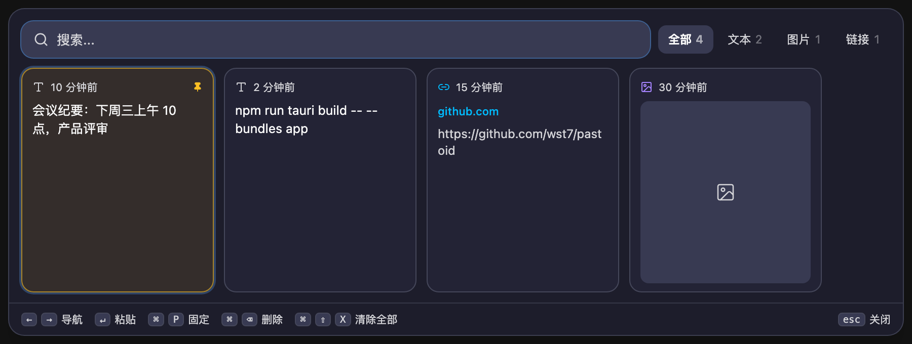

<p align="center">
  
</p>

<h1 align="center">Pastoid</h1>

<p align="center">
  
  
</p>

Pastoid is a lightweight, fast clipboard manager for macOS and Windows. Built with Tauri and React, it runs quietly in the background and keeps your clipboard history always within reach.

## Why Pastoid?

Pastoid keeps your clipboard history at your fingertips — a configurable number of recent items, ready to search and paste in an instant. Whether it's a code block, a URL or a piece of text you copied hours ago — Pastoid keeps it accessible.

## Key Features

- **📋 Automatic History** — Everything you copy is recorded in the background without any extra steps.
- **📌 Pin Important Items** — Keep frequently used snippets at the top of your list for instant access.
- **🔍 Instant Search** — Find any copied item in seconds with real-time search as you type.
- **🌙 Theme Support** — Choose between Light, Dark, or follow your system automatically.
- **🌍 Bilingual** — Full support for both English and Chinese interfaces.
- **🚀 Start with System** — Optional auto-start so Pastoid is always ready when you are.
- **⌨️ Keyboard-First** — Open the quick paste panel with a global shortcut, navigate with arrow keys, and paste without touching your mouse.
- **⚙️ Configurable Limits** — Set how many items to keep (1–100) to balance history depth and performance.

## Screenshots

<p align="center">
  
  <br><br>
  
</p>

## Quick Paste Panel

Press your configured shortcut (default: `Cmd+Shift+V` on macOS, `Ctrl+Shift+V` on Windows) anywhere to instantly summon the quick paste panel. It appears over any app — even full-screen games or videos — so you can paste without breaking your flow.

Inside the panel (same actions, platform-specific keys):

| Action | macOS | Windows |
| --- | --- | --- |
| Navigate | `←` `→` | `←` `→` |
| Paste | `↵` | `Enter` |
| Pin / unpin | `⌘P` | `Ctrl+P` |
| Delete item | `⌘⌫` | `Ctrl+Backspace` |
| Clear all history | `⌘⇧X` | `Ctrl+Shift+X` |
| Close panel | `Esc` | `Esc` |

> On Windows the panel pastes with the system `Ctrl+V` and skips the macOS-style "switch back to the previous app" step — hiding the panel already returns focus.

Images are captured too — screenshots and copied image files show up as thumbnails and paste back as images.

## Privacy by Design

Pastoid stores your clipboard history locally on your machine. No cloud, no account, no tracking. Your data stays yours.

## Installation

### macOS

1. Download the `.dmg` file from the [latest release](https://github.com/wst7/pastoid/releases/latest).
2. Open the `.dmg` and drag **Pastoid** into your **Applications** folder.
3. If you see the message **"Pastoid.app" is damaged and can't be opened**, this is due to macOS Gatekeeper blocking unsigned apps. Run this command in Terminal to allow it:

   ```bash
   xattr -cr /Applications/Pastoid.app
   ```

4. Open Pastoid from your Applications folder. You may need to go to **System Settings → Privacy & Security** and click **Open Anyway** on the first launch.

### Windows

1. Download the `.msi` or `.exe` installer from the [latest release](https://github.com/wst7/pastoid/releases/latest).
2. Run the installer and follow the prompts.
3. Pastoid runs quietly in the system tray; press `Ctrl+Shift+V` to summon the quick paste panel.

> On first launch Windows SmartScreen may warn that the app is unsigned — click **More info → Run anyway**.
