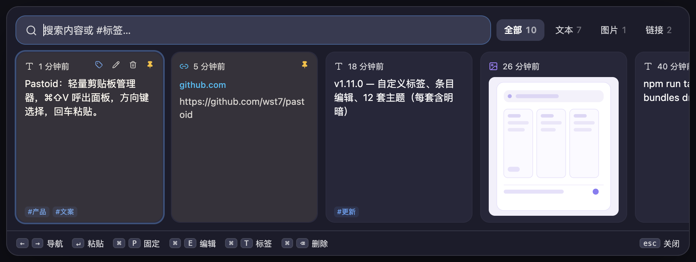

<p align="center">
  
</p>

<h1 align="center">Pastoid</h1>

<p align="center">
  
  
</p>

<p align="center">English | <a href="README_zh.md">简体中文</a></p>

Pastoid is a lightweight, fast clipboard manager for macOS and Windows. Built with Tauri and React, it runs quietly in the background and keeps your clipboard history always within reach.

## Why Pastoid?

Pastoid keeps your clipboard history at your fingertips — a configurable number of recent items, ready to search and paste in an instant. Whether it's a code block, a URL or a piece of text you copied hours ago — Pastoid keeps it accessible.

## Key Features

- **📋 Automatic History** — Everything you copy is recorded in the background without any extra steps.
- **📌 Pin Important Items** — Keep frequently used snippets at the top of your list for instant access.
- **🔍 Instant Search** — Find any copied item in seconds with real-time search as you type.
- **🌍 Bilingual** — Full support for both English and Chinese interfaces.
- **🚀 Start with System** — Optional auto-start so Pastoid is always ready when you are.
- **⌨️ Keyboard-First** — Open the quick paste panel with a global shortcut, navigate with arrow keys, and paste without touching your mouse.
- **⚙️ Configurable Limits** — Set how many items to keep (1–100, or unlimited) to balance history depth and performance.
- **🏷️ Custom Tags** — Tag any item and search tags alongside content; type `#` for suggestions or click a tag on a card to filter. Tagged items are protected from rolling deletion, and Settings can delete everything under a tag in one go.
- **✏️ Edit Items** — Fix a copied snippet in place (`⌘E`) before pasting it.
- **🎨 Theme Styles** — Seven looks: Default, Document, Swiss Style, Aurora, OLED Pure, Wabi-sabi and Neo Brutalism. Each comes in light and dark — pick a mode, or let it follow the system.

## Screenshots

<p align="center">
  
  <br><br>
  
</p>

## Quick Paste Panel

Press your configured shortcut (default: `Cmd+Shift+V` on macOS, `Ctrl+Shift+V` on Windows) anywhere to instantly summon the quick paste panel. It appears over any app — even full-screen games or videos — so you can paste without breaking your flow.

Inside the panel (same actions, platform-specific keys):

| Action | macOS | Windows |
| --- | --- | --- |
| Navigate | `←` `→` | `←` `→` |
| Jump to first / last | `Home` `End` | `Home` `End` |
| Paste | `↵` | `Enter` |
| Pin / unpin | `⌘P` | `Ctrl+P` |
| Edit item | `⌘E` | `Ctrl+E` |
| Edit tags | `⌘T` | `Ctrl+T` |
| Filter category | `⌘1`–`⌘4` | `Ctrl+1`–`Ctrl+4` |
| Delete item | `⌘⌫` | `Ctrl+Backspace` |
| Close panel | `Esc` | `Esc` |

> Pinning and unpinning never make cards jump around while the panel is open: only the pin state changes on the spot, and the order is re-sorted the next time the panel opens (the footer says so). The selection follows the same item, so copying something new won't move the highlight onto a different card.

> On Windows the panel pastes with the system `Ctrl+V` and skips the macOS-style "switch back to the previous app" step — hiding the panel already returns focus.

Images are captured too — screenshots and copied image files show up as thumbnails and paste back as images.

## Privacy by Design

Pastoid stores your clipboard history locally on your machine. No cloud, no account, no tracking. Your data stays yours.

## Data Storage

History and images live in a single folder:

| Platform | Path |
| --- | --- |
| macOS | `~/Library/Application Support/com.wst7.pastoid` |
| Windows | `%LOCALAPPDATA%\com.wst7.pastoid` |

**It is configurable.** On first launch Pastoid asks where to keep its data — accept the default or pick another drive (e.g. `D:\PastoidData`). You can change it later in Settings → Data folder. Pastoid restarts, moves the existing history over, and keeps working. If the target drive is unavailable at startup (an unplugged external disk, say), it falls back to the default folder instead of failing, and the data is left untouched.

What's in the folder:

| File | Purpose |
| --- | --- |
| `history.db` | Clipboard history, stored in SQLite — every change is written through immediately, so a crash can't lose it |
| `clipboard_data.json` | Snapshot from older versions. It is imported into `history.db` automatically on upgrade, then kept as a backup and never modified |
| `images/` | Screenshots and copied images, named by content hash — the same image is only ever stored once |
| `settings.json` | Settings |

Disk usage ≈ number of items × size per item, with images dominating. The **history limit** setting (1–100, or unlimited) caps it. Lowering the limit tells you how many items will be removed and trims right after you confirm — it never deletes behind your back. Items you tagged are exempt from that rolling deletion, and images have their own guard (the 1000 newest untagged images are kept).

## Installation

### macOS

1. Download the `.dmg` file from the [latest release](https://github.com/wst7/pastoid/releases/latest).
2. Open the `.dmg` and drag **Pastoid** into your **Applications** folder.
3. If you see the message **"Pastoid.app" is damaged and can't be opened**, this is due to macOS Gatekeeper blocking unsigned apps. Run this command in Terminal to allow it:

   ```bash
   xattr -cr /Applications/Pastoid.app
   ```

4. Open Pastoid from your Applications folder. You may need to go to **System Settings → Privacy & Security** and click **Open Anyway** on the first launch.

### Windows

1. Download the `.msi` or `.exe` installer from the [latest release](https://github.com/wst7/pastoid/releases/latest).
2. Run the installer and follow the prompts.
3. Pastoid runs quietly in the system tray; press `Ctrl+Shift+V` to summon the quick paste panel.

> On first launch Windows SmartScreen may warn that the app is unsigned — click **More info → Run anyway**.
