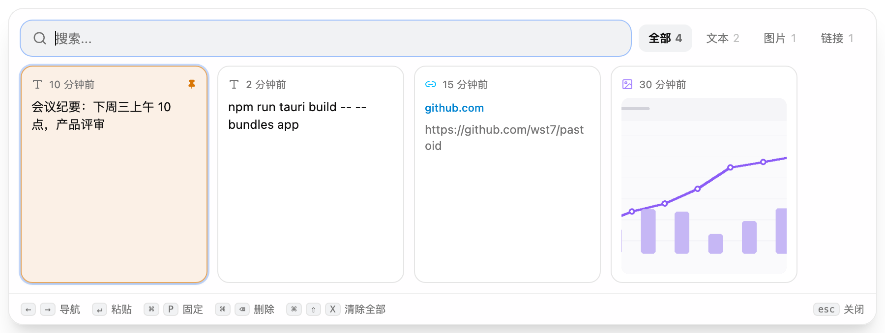
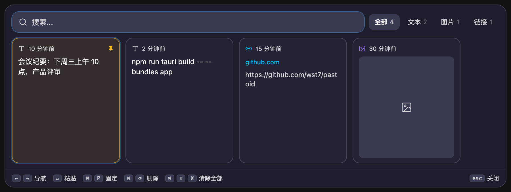

# Pastoid 剪贴板管理器

<p align="center">
  
</p>

<p align="center">
  
  
</p>

Pastoid 是一款轻量、快速的剪贴板管理器，支持 macOS 和 Windows。基于 Tauri 和 React 构建，后台静默运行，剪贴板历史触手可及。

## 为什么选择 Pastoid？

你的剪贴板是电脑上最常用的工具，但它一次只能记住一条内容。Pastoid 将最近的若干条目保存在手边，随时可以搜索和粘贴。无论是代码片段、网址，还是几小时前复制的一段文字，Pastoid 都能让你快速取用。

## 核心功能

- **📋 自动记录** — 在后台记录你复制的所有内容，无需额外操作。
- **📌 置顶重要条目** — 将常用片段固定在列表顶部，随手取用。
- **🔍 实时搜索** — 边打字边搜索，秒速找到任意复制过的内容。
- **🌙 主题切换** — 支持浅色、深色，或跟随系统自动切换。
- **🌍 双语界面** — 完整支持中文和英文界面。
- **🚀 开机启动** — 可选开机自启动，随时待命。
- **⌨️ 键盘优先** — 全局快捷键（macOS `Cmd+Shift+V` / Windows `Ctrl+Shift+V`）呼出快速粘贴面板，方向键导航，鼠标不用碰。
- **⚙️ 历史条数可调** — 设置保留条数（1–100 条），灵活平衡历史深度与性能。

## 截图

<p align="center">
  
  <br><br>
  
</p>

## 快速粘贴面板

在任何应用中按下设定好的快捷键（macOS 默认 `Cmd+Shift+V`，Windows 默认 `Ctrl+Shift+V`），即可立即调出快速粘贴面板。它会悬浮在任何应用之上——即使在全屏游戏或视频中——让你无需中断流程即可粘贴。

面板内操作（下表 macOS / Windows 写法不同，按键语义一致）：

| 操作 | macOS | Windows |
| --- | --- | --- |
| 左右切换 | `←` `→` | `←` `→` |
| 粘贴 | `↵` | `Enter` |
| 置顶 / 取消置顶 | `⌘P` | `Ctrl+P` |
| 删除条目 | `⌘⌫` | `Ctrl+Backspace` |
| 清空全部历史 | `⌘⇧X` | `Ctrl+Shift+X` |
| 关闭面板 | `Esc` | `Esc` |

> Windows 上粘贴走的是系统 `Ctrl+V`，不会像 macOS 那样先切回上一个应用（Windows 隐藏面板后焦点会自己还回去）。

截图和复制的图片文件也会被收进历史，以缩略图展示，回车即可按图片粘贴。

## 隐私设计

Pastoid 将剪贴板历史存储在本地机器上。无云端、无账号、无追踪。你的数据只属于你。

## 数据存储

历史与图片都在一个目录里，默认位置：

| 平台 | 路径 |
| --- | --- |
| macOS | `~/Library/Application Support/com.wst7.pastoid` |
| Windows | `%LOCALAPPDATA%\com.wst7.pastoid` |

**可以改。** 首次启动时 Pastoid 会直接问你要把数据放在哪，可以选默认位置，也可以选别的盘（比如 `D:\PastoidData`）。之后随时可以在 设置 → 数据目录 里改。改动后应用会自动重启，并把现有历史一起搬过去；如果目标盘当时不可用（比如移动硬盘没插），会自动回落到默认目录继续工作，不会丢数据。

占用空间 ≈ 历史条数 × 单条内容大小，图片是大头。设置里的「历史条数」（1–100）可以直接控制上限——超出条数的旧条目会被清掉，对应的图片文件也会一并删除，不会无限增长。

## 安装

### macOS

1. 从 [最新发布页](https://github.com/wst7/pastoid/releases/latest) 下载 `.dmg` 文件。
2. 打开 `.dmg`，将 **Pastoid** 拖入 **应用程序** 文件夹。
3. 若看到提示「Pastoid.app 已损坏，无法打开」，这是 macOS Gatekeeper 阻止了未签名应用。在终端运行以下命令解除限制：

   ```bash
   xattr -cr /Applications/Pastoid.app
   ```

4. 从应用程序文件夹打开 Pastoid。首次启动可能需要在 **系统设置 → 隐私与安全性** 中点击「仍然打开」。

### Windows

1. 从 [最新发布页](https://github.com/wst7/pastoid/releases/latest) 下载 `.msi` 或 `.exe` 安装包。
2. 运行安装程序，按提示完成安装。
3. 安装后 Pastoid 会在托盘区静默运行，按 `Ctrl+Shift+V` 呼出快速粘贴面板。

> Windows 首次运行可能弹出 SmartScreen 提示（应用未做代码签名），点击「更多信息 → 仍要运行」即可。
